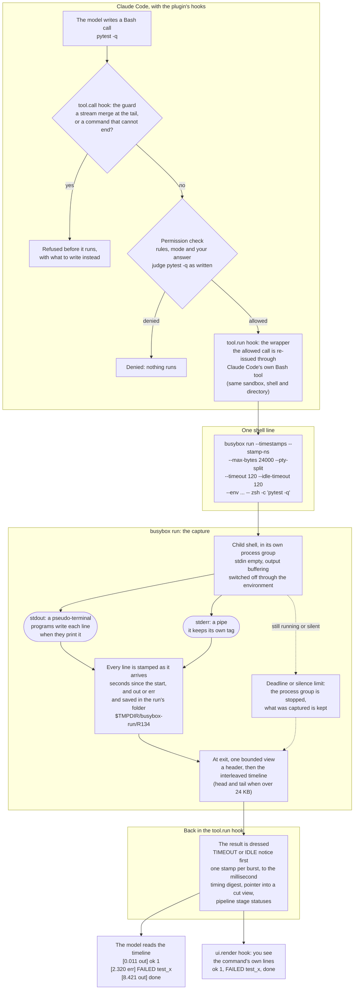

# managed-tools: Pi-Time for Claude Code

A Claude Code plugin that makes every Bash result a **timeline**. It is the Claude Code
port of the Pi-Time feature of [pi-managed-tools](https://github.com/rob-c/pi-managed-tools).

## Install

```sh
claude plugin marketplace add rob-c/claude-managed-tools
claude plugin install managed-tools@rob-c
```

Start a new session, and `/pi-time` shows what is in force. macOS and Linux; there is no
Windows build. On its first start the plugin downloads the one binary it needs, checked
against its published sha256: see [The binary it needs](#the-binary-it-needs). Later
releases arrive with `claude plugin update managed-tools@rob-c` (auto-update is off for a
marketplace you add yourself; `/plugin` > Marketplaces turns it on).

## What it does

**Pi-Time** is the name for what the wrapper gives the model: the concept of time, which a
plain text capture of an execution does not carry. Three facts come back with every
command, each there because its absence made a model misread a run:

- **Which stream.** Every line is tagged `out` or `err`, so a warning on stderr is never
  misread as program output.
- **When.** A microsecond offset on every line, and a `timing:` digest on slow runs, so
  ordering, durations and silences are readable facts. A merged capture does not just lack
  them, it lies: block buffering puts a 0 s stdout burst after an 8 s stderr line.
- **How long is too long.** A default deadline of 120 s on every command — Claude's and
  your own — so a hang ends in a named `TIMEOUT` with its partial capture intact instead
  of an exit code that reads like a failure.

The model reads:

```
run=R134 exit_code=0 duration_ms=8421
[0.011 out] collecting
collected 3 items
ok 1
[2.320 err] FAILED test_x
[8.421 out] done
--- pi-time ---
timing: 8.42s total, 5 lines, output from 0.01s, stderr from 2.32s, longest pause 6.10s (2.32s → 8.42s)
```

A stamp starts a burst: seconds since the command started, and the stream. The lines
under it with no stamp arrived at that same millisecond on that same stream, so every
change of stream is marked and nothing is repeated. After `--- pi-time ---` come the
capture's own notes. The capture itself keeps nanoseconds; `busybox log` prints them.

You see the command's own lines:

```
⏺ Bash(pytest -q)
  ⎿  ok 1
     FAILED test_x
     done
```

## The binary it needs

It needs one binary: `busybox` from [rob-c/busybox-static](https://github.com/rob-c/busybox-static)
(a host BusyBox will not do — upstream has no `run` or `log` applet). The plugin fetches
it and keeps it current itself:

- **Which build:** the latest release's asset for this machine — `darwin-universal` on
  macOS (one file for Apple silicon and Intel), `linux-amd64` or `linux-arm64` on Linux.
  There is no Windows build.
- **When:** on the first session, and after that at most once a day, behind the session
  rather than in front of it. `/pi-time update` checks now; `/pi-time install` fetches
  and replaces regardless.
- **Verified before use:** the download is checked against the sha256 GitHub publishes for
  the asset, made runnable, and asked for its feature list. Only then is it moved into
  place, in one step. No checksum, a mismatch, or a file that will not run: nothing is
  installed and whatever was in use stays in use.
- **Where:** `~/.claude/plugins/data/<plugin>/bin/busybox`. That copy is used first. A copy
  pi-managed-tools keeps at `~/.pi/agent/bin/busybox` is used when ours is absent, and an
  explicit path (the `busybox` option or `CLAUDE_MANAGED_TOOLS_BUSYBOX`) wins over both —
  that is how to run a local build.
- **Newer features are asked for only when the binary declares them** (`busybox --caps`):
  nanosecond offsets, the idle timeout and the `log` queries need 0.6.0; an older build
  keeps working with the flags it knows. `/pi-time` says which build is in use and what it
  can do. The offsets' shape is not declared anywhere, so every shape is read: padded (to
  0.6.0) and unpadded (0.6.1 on), with one to nine decimals.
- **And it is run once before any command is trusted to it.** What a build declares is not
  what it does, so at session start the plugin runs one wrapped `echo` with the flags a
  real command will get. A build that cannot return that as a timeline is passed over —
  Bash then runs as written, and `/pi-time` says why — rather than failing every call. The
  line it printed is also where the model's examples come from: the system prompt quotes
  the header and the offsets in the shape this build really prints.

With no usable binary — offline on a first start, or `autoUpdate` off — the plugin does
nothing at all: Bash runs exactly as before.

Checked on macOS (arm64) in live sessions, and on Linux (arm64, Debian) by running the
binary, the wrapper and the shell shim in a container; Claude Code itself was not run on
Linux.

### From a clone

To work on the plugin, try it for one session:

```sh
claude --plugin-dir ~/src/claude-managed/tools
```

Keep it installed, from this folder (edits here are picked up by `/reload-plugins`):

```sh
claude plugin marketplace add ~/src/claude-managed/tools
claude plugin install managed-tools@rob-c
```

Then `/pi-time` shows what is in force.

## How it works

Five function hooks in [`hooks/register.tsx`](hooks/register.tsx):

| Hook | What it does |
|---|---|
| `tool.call` on Bash | The guard: a command ending in `2>&1`, `\|&` or `&>`, or one that cannot end on its own here (a pager, an editor, `tail -f`, a foreground server), is refused before the permission check, with the rewrite. |
| `tool.run` on Bash | The wrapper: the call is re-issued as `busybox run --timestamps … -- <shell> -c '<command>'`. A `TIMEOUT`, `IDLE`, `CANCELLED` or `KILLED` notice goes in front of the result; the digest, the pointer into a truncated view and the notes on what the command hid go after it. |
| `ui.render` on the tool row | Your view: the same result drawn without the stamps and the header (the stored result keeps them), and while a command runs, its newest lines and a sign of life. |
| `prompt.compose` | Tells the model what the timeline is, only while it is on. |
| `command.run` | `/pi-time`, and `/sh <command>` for commands you run yourself. |

### Permissions are judged on the command as written

The wrapper runs at `tool.run`, which fires only *after* a call has been allowed. Rules,
the permission mode, the auto-mode classifier and your own answer at the prompt all judge
`npm test` — never `busybox run … -c 'npm test'`. An allow rule such as
`Bash(npm test:*)` keeps matching, a deny rule such as `Bash(rm:*)` keeps refusing, and the
prompt shows the command the model wrote. Only then is the allowed command re-issued,
wrapped, through Claude Code's own Bash tool — so the sandbox, the shell snapshot and the
working directory are the ones an unwrapped call would have had.

This ordering is the reason the plugin uses function hooks. A `PreToolUse` command hook
can only rewrite the command *ahead* of the permission check, after which every allow rule
stops matching and every deny rule is blind to the real command.

Checked live: with `--allowedTools "Bash(echo:*)"`, `echo` ran wrapped and `touch` was
still refused; with a `Bash(touch:*)` deny rule, `touch` was denied.

## What is different from plain Bash

Worth knowing before you turn it on:

- **A running command shows its newest lines and a sign of life.** `busybox run` prints
  its view when the command ends, so the plugin reads the capture as it grows and draws
  the last few lines under the command's row, with one line that says it is alive:
  `running 47s · last output 31s ago · CPU busy (98% of a processor): working`, or
  `CPU idle: waiting on something`. The processor is read from `ps` for the command's own
  process group, every three seconds. Nothing is read for the first second and a half, so
  a quick command pays nothing. The model is sent none of this; it reads the result. The
  `live` option turns it off.
- **Every command with no timeout of its own is stopped at the deadline** (120 s by
  default) and comes back as a `TIMEOUT`: a Bash call that names no `timeout`, and the
  commands you run yourself with `!` or `/sh`. A call's own `timeout` still wins. Claude
  Code documents that hooking a tool's run also turns off its own move-to-background for
  that tool, so a slow foreground command is ended, not backgrounded. For Claude's calls,
  raise `timeout` or use `run_in_background`; for your own, `/pi-time timeout <seconds>`
  (or `off`) changes the deadline for the session.
- **A command with no sign of life for 120 s is stopped**, whatever its deadline, and
  comes back as `IDLE`. A sign of life is a line on either stream *or* processor time: a
  compiler that prints nothing for five minutes is working and is left alone, and a
  command blocked on a lock or a prompt is waiting and is stopped. The line between them
  is a hundredth of a processor over the silence. Under the default deadline this changes
  nothing (the deadline fires first when the two are equal); it matters when a call raises
  its `timeout`: a command given ten minutes that hangs at once comes back after two. A
  command that is *meant* to wait — `sleep 300`, a server — is still stopped, and belongs
  in `run_in_background`. `/pi-time idle <seconds|off>` changes the limit for the session.
  When a deadline fires on a watched command, its `TIMEOUT` says what the processor was
  doing: "it used 117.3s of processor time in 120s … it was working, not stuck" or "…none
  at the end … waiting on something", so the model knows whether more time would help.
- **Where a command cannot be watched, silence alone decides, as before.** The watch
  needs the command's shell to write one small file in the plugin's data folder. In
  Claude Code's sandbox it cannot; after the first such call the plugin stops trying, and
  those calls get the capture's own limit (`--idle-timeout`), which knows only output.
  Your own `!` and `/sh` commands use that limit too.
- **A command that cannot end is refused before it runs.** Nobody can press `q` or Ctrl-C
  for a command here, so a pager (`git log | less`), an editor, `tail -f`, `watch`, `top`,
  `git rebase -i` or a foreground server (`npm run dev`, `python3 -m http.server`) would
  only run to the deadline and come back as a `TIMEOUT` with nothing learned. The refusal
  names what to write instead — for a server, the same call with `run_in_background`. Only
  the command word of a statement is judged: `tail -f log | grep -m1 ready`,
  `timeout 20 tail -f log`, a backgrounded `npm run dev &` and the word inside a quoted
  string all pass. Appending `# pitime-safe` lets one through; the `guard` option turns it
  off together with the merge guard.
- **Background commands are not wrapped**, so they have no timeline and no deadline: they
  run exactly as before. The same goes for a command that ends with `# pitime-raw`, which
  keeps Claude Code's own default.
- **The command runs in a child of the Bash tool's shell**, in the same kind of shell
  (your bash or zsh), with the same environment and directory. Aliases and shell functions
  from your profile are not available inside it. A successful `cd` is carried back, so it
  still persists between calls.
- **stdout is a terminal, 200 columns by 50 rows.** `isatty(1)` is true for the command;
  stdin is empty and stderr is a pipe. Colour, pagers and prompts are switched off through
  the environment. Programs that format for a terminal do so: `ls` prints names in columns
  (`ls -1` for one per line) and `ps` cuts lines at the width (`ps -ww`). The model is
  told both. The size is fixed so that the view does not depend on your window.
- **In the sandbox there is no pseudo-terminal.** The first sandboxed call finds that out
  and the wrapper falls back to plain pipes for the session: stream tags stay exact, and
  timing is as good as the table under [Buffering](#buffering) says for a pipe.
- **Bulk output through C tools is slower on macOS.** Line-buffering every C-stdio
  program has a price where there are millions of lines: see [Buffering](#buffering).
- **Other hooks see both spellings, and run twice.** Your own `PreToolUse` and
  `PostToolUse` hooks fire for the original command and again for the wrapped one (its
  `tool_use_id` starts `toolu_plugin_`). A hook that counts or logs Bash calls will see
  two per call, and a slow hook is paid for twice. If a hook refuses the wrapped spelling,
  the call fails with an explanation rather than running unwrapped behind its back. The
  wrapped spelling's own result ends with one `pitime_facts …` line (the child shell's
  report), which the plugin reads and removes before the model or the transcript sees it.
- **Each call costs about 0.1 s more**, plus your own hooks' second run. Measured on one
  machine: 10 ms unwrapped, about 100 ms wrapped, about 300 ms with a Python
  `PreToolUse`/`PostToolUse` hook installed.
- **The view is capped at 24 KB** (`normal`), under Claude Code's own inline limit of about
  30 KB. A longer run says `truncated=true` and shows the head and the tail of the output
  with the cut marked between them; the line after it names the omitted lines, how many of
  them are on stderr (a view with no `[err]` line otherwise reads as "no errors"), and the
  command that reads them. Without the wrapper Claude Code moves such a result to a file
  and shows the model its first 2 KB.
- **A stamp starts a burst, and offsets are to the millisecond.** A line that arrived at
  the same offset and on the same stream as the line above it carries no stamp. A line at
  the same offset that needs a mark — another stream, or text of its own that begins with
  `[` or looks like the capture's — reads `[= err] text`. See [What it costs in
  tokens](#what-it-costs-in-tokens) for why. `compactStamps` off puts a stamp on every
  line again, and `stampDigits` sets the decimals (9 is what the capture keeps).
- **The header is one line.** `run=R12 exit_code=0 duration_ms=328`, with `timed_out=true`,
  `idle=true` or `cancelled=true` only when one of them is, and a second line with the
  line counts only when the view was cut.
- **A pipeline's result says how each stage ended, when that differs from the exit code
  shown.** The child shell leaves the statuses of its last pipeline behind
  (`pipeline stage statuses: 1 141 0`), so a `cmd | head` whose stages all exited 0 earns
  no caveat at all, and a failed earlier stage is named instead of guessed at. A note the
  model has already been given in full this session comes back in a few words.
- **Captures are kept by count and age, not pruned by each run.** `busybox run` keeps every
  capture under `$TMPDIR/busybox-run`, one folder for every session on the machine: this
  plugin's, a subagent's, pi's. Through 0.4.1 each run passed `--prune 20`, so twenty
  commands anywhere deleted a capture another session had just been told to read. Now a
  run is removed only when 200 newer ones exist *and* it is more than two hours old; the
  sweep runs at session start and every 25 commands. A capture can be large (up to 64 MiB a
  stream), so a machine that produces many large ones will hold more of them than before.
- **Esc during a command stops it, and its partial output is not shown.** The model is
  told the call was interrupted; nothing is left running.

Smaller things: a command that sets its own `EXIT` trap does not get its `cd` carried, nor
its pipeline's statuses reported; a direct `busybox sh -c '…'` (or `env`, `timeout`,
`nice`, `nohup`, `time`) is wrapped like any other command, while `busybox log`, `run` and
the other applets that print their own record are left as written;
under bash, a syntax error on a command's first line quotes the wrapper's short prelude
before the command; a shell killed by a signal comes back as `KILLED` with exit code 1.

End a command with `# pitime-raw` to run that one call unwrapped, or `/pi-time off` for
the session. Neither is needed for exact bytes: a pipe, a redirect or a checksum inside a
command sees the real bytes already; only the result read back carries the offsets.
(`command <cmd>` was the per-call escape through 0.4.0. It is the shell's builtin, it was
taken by habit and by accident far more often than on purpose, and it now runs wrapped
like anything else.)

## Buffering

An offset is only the truth if the program wrote the line when it printed it. On a
terminal most runtimes do, which is why stdout is one here. But a program's stdout is
often not the terminal: it is a stage inside a pipeline (`make | tee build.log`,
`./server | grep ERROR`), it is redirected to a file a later command reads
(`./server > srv.log &`), or — in the sandbox — it is a plain pipe. There a runtime that
block-buffers keeps its lines until 4–64 KB have piled up or it exits, and every offset
is then the flush.

So the wrapper switches buffering off through the environment, for every runtime that
can be told from outside. Measured with one probe per runtime (print a line, wait a
second, print another, stdout a pipe), on macOS 27 and Debian 12:

| Runtime | On a pipe, untouched | With the wrapper | How |
|---|---|---|---|
| sh builtins, Node, Deno, Bun, PHP, Tcl, R, Java, Elixir, Go, Rust, C++ iostream, `make` | live | live | nothing needed |
| Python | late | live | `PYTHONUNBUFFERED=1` |
| Ruby | late | live | `RUBYOPT=-r<prelude>` setting `$stdout.sync` |
| Perl | late | live | `PERL5OPT=-I<dir> -MPiTimeUnbuffer`, a module setting `$\|` |
| Lua, LuaJIT | late (LuaJIT) | live | `LUA_INIT=io.stdout:setvbuf[[line]]` |
| C stdio on macOS: compiled C, Swift, `grep`, `sed`, `awk`, `cut`, `tr`, `jq` | late | live | `STDBUF1=L`, read by the C library itself (`setvbuf(3)`) |
| C stdio on Linux: the same programs | late | late — live with `preloadStdbuf` | glibc reads no variable; `stdbuf`'s `LD_PRELOAD` library does it |
| Haskell (GHC) | late | late | none from outside; live on the terminal |
| OCaml `Printf`, `mawk` | late | late | none; late on a terminal too (`print_endline`, `mawk -W interactive`) |

Stderr was live everywhere but OCaml's `Printf`, so it is left alone. docker's and pip's
progress output were checked too and needed nothing: they already arrive as plain lines
here.

- **Your own settings survive.** `RUBYOPT`, `PERL5OPT`, `MAVEN_ARGS` and `GRADLE_OPTS` are
  appended to, never replaced, so a `GRADLE_OPTS=-Xmx4g` still reaches the build.
  `LUA_INIT` is only set when you have none, and the preload is added to an `LD_PRELOAD`
  you already have.
- **The cost is bulk output.** A line at a time is a system call at a time. Measured on
  macOS with `STDBUF1=L`: five million lines through `seq | awk | grep` took 5.5 s instead
  of 1.9 s, and `seq 1 5000000 > file` 15.5 s instead of 0.6 s — about 3 µs a line, so
  nothing you would notice below a million lines. For one command, `STDBUF1=F sort big >
  out` gives it its block buffer back; `extraEnv` set to `STDBUF1=F` does that for every
  command and keeps the rest; the `unbuffer` option turns all of it off.
- **Linux needs a preload for C tools, and it is off by default.** `preloadStdbuf` loads
  GNU coreutils' `libstdbuf.so` into every command, as `stdbuf -oL` does. It reaches every
  program a command starts, and an AddressSanitizer build refuses to run under it, which
  is why you have to ask. Without it the model is told to use `grep --line-buffered`,
  `sed -u` or `stdbuf -oL` where a stage's timing matters.

## Your own commands: `!` and `/sh`

### `!command`: your shell, inside the capture

A `!` command raises no event before it runs — no tool call, no prompt submission, and
the `!` key itself is not an edit a plugin sees (all three measured) — so no hook can wrap
it. What Claude Code does honour is `CLAUDE_CODE_SHELL`, the program it launches as "the
shell". At session start the plugin writes a small shim and points that variable at it,
for this session only. The shim *is* your real shell for every launch, and for one
recognised case it runs your shell inside `busybox run`:

```
❯ ! pytest -q
  ⎿  run=R134 exit_code=1 duration_ms=8421
     [0.011 out] ok 1
     [2.320 err] FAILED test_x
     [8.421 out] done
     --- pi-time ---
     timing: 8.42s total, 3 lines, output from 0.01s, stderr from 2.32s, longest pause 6.10s (2.32s → 8.42s)
```

- **It is your shell, as Claude Code launches it.** The shim hands the host's own command
  line to your real shell unchanged, so your profile's aliases and functions, `cd`
  carrying to the next command, and the exit status all behave as they do without it.
- **You see the timeline too.** Claude Code draws a `!` result itself, from the same text
  the model reads, and raises nothing a plugin could draw differently. Use `/sh` when you
  want the timeline kept off your screen.
- **Only a `!` command is wrapped, and it is recognised positively.** Tool calls, the
  Monitor tool, background commands and a skill's inline commands all launch the shell the
  same way, and most need raw output. So the plugin keeps a sha256 of what is in the prompt
  box (in its data folder; the text itself is never written), and the shim wraps a launch
  only when its command is exactly that text. Anything else — and any doubt: a missing
  file, another session, a launch it does not recognise — runs your real shell untouched.
- **The default deadline applies** (120 s). A `!` command still running then is stopped,
  its header says `timed_out=true`, and Claude is told it was a deadline and not a
  failure. `/pi-time timeout <seconds>` gives your commands longer for the session and
  `/pi-time timeout off` removes the deadline; a command that ends with `# pitime-raw` runs
  outside the capture, exactly as Claude Code runs a `!` command without the plugin.
- **So does the silence limit** (120 s without output), while there is a deadline: with
  the deadline off, a `!` command runs until it finishes. `/pi-time idle <seconds|off>`
  changes it.
- **Costs:** a keystroke in the prompt box now also writes a 64-byte file, and every shell
  launch passes through one extra `/bin/sh` `exec`.

`PITIME_SHIM_TRACE=/some/file claude` records why each launch was or was not wrapped (the
decision, never the command). The `wrapBang` option turns the shim off; `/pi-time off`
makes it a plain pass-through for the session.

### `/sh <command>`: the same, off your screen

`/sh <command>` runs a command through the capture without the shim:

```
❯ /sh pytest -q
  ⎿  managed-tools: exit 1 · 8.42s
     ok 1
     FAILED test_x
     done
```

You see how it ended and the command's own lines; Claude reads the full timeline, digest
and notes, framed as something you ran rather than something asked of it. It runs in the
session's shell and directory, `cd` carries, and it is stopped at the default deadline
(120 s) like any other command; the row then reads `timed out`. `/pi-time timeout
<seconds>` raises it, up to the longest Claude Code allows a Bash call (ten minutes), which
is also what `/sh` gets with the deadline off.

Like `!`, it runs with nobody asked. So it only runs when the line is yours: Enter at the
prompt, your message over Remote Control, or the prompt a host was started with
(`claude -p "/sh …"`). A `/sh` line that arrives from a peer session, a channel, a
schedule or another plugin is refused. Unlike `!`, it does not start a reply from Claude;
the result is there when you next ask. It runs in a child of the session's shell, so —
unlike `!` through the shim — your aliases and functions are not available in it.

## Settings

Plugin options (`/config`, or `pluginConfigs` in settings), each overridable for one
session by an environment variable:

| Option | Environment | Default | Meaning |
|---|---|---|---|
| `enabled` | `CLAUDE_MANAGED_TOOLS_WRAP` | on | Wrap foreground Bash commands. |
| `verbosity` | `CLAUDE_MANAGED_TOOLS_VERBOSITY` | `normal` | `quiet` 6 KB, `normal` 24 KB, `verbose` 27 KB (the most Claude Code shows inline), `brief` (repeats collapsed, no per-line timing). |
| `pty` | `CLAUDE_MANAGED_TOOLS_PTY` | `split` | `split` (stdout a pty, stderr a pipe), `off`, `merged`, `raw`. |
| `timeoutSeconds` | `CLAUDE_MANAGED_TOOLS_TIMEOUT` | 120 | Default deadline for every command that names none: a Bash call with no `timeout`, and your own `!` and `/sh` commands. 0 leaves Claude Code's own default in charge of Bash calls and puts no deadline on yours. |
| `idleSeconds` | `CLAUDE_MANAGED_TOOLS_IDLE` | 120 | Stop a command that shows no sign of life for this long — no output and no processor time — whatever its deadline, as a named `IDLE`. 0 or `off` removes the limit. |
| `unbuffer` | `CLAUDE_MANAGED_TOOLS_UNBUFFER` | on | Switch programs' output buffering off through the environment (see [Buffering](#buffering)). |
| `preloadStdbuf` | `CLAUDE_MANAGED_TOOLS_PRELOAD` | off | Linux: preload `stdbuf`'s library so C-stdio programs line-buffer too. |
| `autoUpdate` | `CLAUDE_MANAGED_TOOLS_UPDATE` | on | Keep the plugin's own busybox at the latest release (one GitHub request a day). |
| `compactStamps` | `CLAUDE_MANAGED_TOOLS_COMPACT_STAMPS` | on | One stamp per burst: a line at the offset and on the stream of the one above carries none. Off puts a stamp on every line. |
| `stampDigits` | `CLAUDE_MANAGED_TOOLS_STAMP_DIGITS` | 3 | Decimals of an offset the model is shown, 1 to 9. The capture keeps nanoseconds either way. |
| `live` | `CLAUDE_MANAGED_TOOLS_LIVE` | on | Show a running command's newest lines and a sign of life under its row, and judge "stuck" by the processor as well as by silence. |
| `guard` | `CLAUDE_MANAGED_TOOLS_GUARD` | on | Refuse a stream merge at a command's tail, and a command that cannot end on its own here. |
| `carryCwd` | — | on | Keep a successful `cd` between calls. |
| `wrapBang` | — | on | Run your own `!` commands inside the capture, through the shell shim. |
| `cleanDisplay` | — | on | Draw results without the timeline on screen. |
| `busybox` | `CLAUDE_MANAGED_TOOLS_BUSYBOX` | — | Absolute path to the binary. |
| `extraEnv` | `CLAUDE_MANAGED_TOOLS_EXTRA_ENV` | — | `NAME=VALUE,…` for every wrapped command, after the wrapper's own, so a pair here wins. |

The binary is looked for at the explicit path, then in this plugin's data folder, then at
`~/.pi/agent/bin/busybox`.

`/pi-time` · `/pi-time on|off` · `/pi-time verbosity <level>` · `/pi-time pty <mode>` ·
`/pi-time timeout <seconds|off>` · `/pi-time idle <seconds|off>` · `/pi-time update` ·
`/pi-time install` · `/sh <command>`

## Development

No build step and no dependencies: the hooks module is TypeScript the engine loads as is.

```sh
claude plugin validate .   # what the module hooks, calls and reads
claude plugin test .       # 327 tests, pure logic and the hooks against the engine
tsc -p .                   # after one interactive load has laid .claude-plugin/types
```

`src/wrap.ts`, `src/timing.ts`, `src/guard.ts` and `src/display.ts` are ported from
pi-managed-tools and import nothing from either host; a fix to one usually belongs in
both repositories. `tests/hardening.test.ts` holds the rules that came across from pi's
0.23.0 hardening pass, one group per thing that had been assumed and is now measured. `src/policy.ts` (deadlines, shell), `src/busybox.ts` (finding and
installing the binary) and `src/prompt.ts` are specific to Claude Code.

Written and tested against Claude Code 2.1.331.

## What it costs in tokens

The timeline is not free: everything the plugin adds to a result is read by the model, and
stays in the conversation for every later turn. So it is measured, with the API's own
count, on results from real sessions.

Sixty wrapped results (1,816 lines of output, 45,700 tokens of the commands' own text):

| What the model was sent | Tokens the plugin added | Per result | On top of the output |
|---|---|---|---|
| 0.4.1: a nanosecond stamp on every line, a three-line header | 24,500 | 408 | 54% |
| 0.5.0: `[= out]` for a repeated offset | 19,000 | 317 | 42% |
| 0.6.0: one stamp per burst, to the millisecond, a one-line header | 6,200 | 103 | 14% |

Where it went:

- **Stamps.** `[0.030555209 out] ` is eighteen characters and about ten tokens: digits are
  expensive to a tokenizer. Output arrives in bursts — over 13,616 lines from 416 results,
  54% share their offset with the line above to the nanosecond and 86% to the millisecond —
  so a stamp per burst says the same thing in a fraction of the tokens.
- **The header.** Three lines were 76 tokens a call; one line is 20. Four results in ten
  are under 600 characters, and for those the header was half the text.
- **The system prompt section and the skill's description**, which are read on every
  request: 1,867 tokens before, 1,239 now. The long form of each paragraph is in the
  skill, which is loaded only when it is needed.

Before the format changed, a model (Claude Haiku) was asked eight questions with known
answers about one result in the new spelling — which stream a line arrived on, at what
offset, how long between two lines, whether a line was output or a note. It answered all
eight in every run: five in this spelling, and four each in three other candidates. That is
one small result and one model, so it shows the spelling can be read, not that it always is.

To spend less still: `verbosity` `quiet` caps a view at 6 KB instead of 24. To spend
more for more precision: `stampDigits` 9, and `compactStamps` off.

## How a command becomes a timeline, and why

`dmesg` prints the kernel's log as `[    0.011354] message`: one line per event, each with
the seconds since boot. Pi-Time gives a command's output the same shape — seconds since
the command *started*, and the stream the line arrived on.

### Why

One program, three lines, 0.3 s apart: `ok 1` on stdout, `FAILED test_x` on stderr, `done`
on stdout. Measured here with a six-line Python script:

```
what the program did            a plain capture returns   Pi-Time returns
-----------------------------   -----------------------   -------------------------------
0.04 s  stdout  ok 1            FAILED test_x             [0.038778666 out] ok 1
0.34 s  stderr  FAILED test_x   ok 1                      [0.341038958 err] FAILED test_x
0.65 s  stdout  done            done                      [0.646061250 out] done
```

The plain capture is wrong about the order, and says nothing about which stream or when.
The program's stdout is a pipe there, so the runtime holds `ok 1` back until it exits, and
the failure that came second arrives first: it reads as a failure before any test had
passed. Nothing in a plain capture can show that this happened.

### How



Each step is where it is for a reason:

1. **The guard runs before the permission check**, because nobody should be asked to
   approve a command that will be refused anyway. `2>&1` at a command's tail merges the
   streams inside the command, before anything can tag them; a pager or `tail -f` would
   only run to the deadline.
2. **The wrapper runs after the permission check.** Rules, the mode and your own answer
   judge `pytest -q`, never `busybox run … -c 'pytest -q'`, so every allow and deny rule
   you have keeps meaning what it meant.
3. **stdout is a pseudo-terminal and stderr is a pipe.** A runtime line-buffers when its
   stdout is a terminal, so an offset is the moment of the write and not of a flush at
   exit — the fault in the table above. stderr is unbuffered either way, and on its own
   pipe it stays tagged `err`. Where a program's stdout is not the terminal (a stage in a
   pipeline, a redirect to a file), buffering is switched off through the environment
   instead: see [Buffering](#buffering).
4. **Lines are stamped on arrival, in one interleaved stream.** Two streams captured
   apart cannot be put back in order afterwards; one stream with an offset on every line
   keeps the order and the intervals.
5. **The deadline belongs to the capture, not to the host.** It is set to fire before
   Claude Code's own would, so a hang ends with its timeline intact and a named `TIMEOUT`
   rather than with nothing.
6. **The view is bounded and the capture is not.** What comes back fits under Claude
   Code's inline limit; everything the command printed is in the run's folder, and
   `busybox log R134` reads any part of it.
7. **The hook dresses the result last**, with what only it knows: which deadline fired,
   which lines a cut view is missing, how each stage of a pipeline ended.
8. **Two readers, one result.** The stored result, which the model reads, keeps every
   offset; the row you see is the same text with the offsets taken off.

The flags shown are abridged. A `!` command you type takes a shorter path to the same
capture, through the shell shim: see [Your own commands](#your-own-commands--and-sh).

## Licence

GPL-2.0-only, as pi-managed-tools.
